# MineSync

#### Share one Minecraft server between friends, whoever's PC is hosting tonight.

[](LICENSE)
[](https://ztnet.network)
[](#installation)
[](server)
[](https://github.com/ales-drnz/minesync)
[](https://www.patreon.com/cw/ales_drnz)
[](https://www.buymeacoffee.com/ales.drnz)

<table>
<tr>
<td valign="middle" width="90">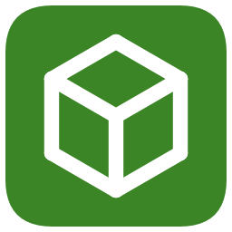</td>
<td valign="middle">`minesync` keeps a Minecraft server folder (vanilla or a full modpack: Forge, NeoForge, Fabric, Quilt) in sync between the PCs of a group of friends on a private [ZeroTier](https://www.zerotier.com) network. A small **hub** (one Docker container, e.g. on a NAS) owns the world and its history; whoever wants to play opens the **client**, presses **G**, and the client takes the lock, downloads only what changed, starts the server with an embedded console, saves and uploads every 5 minutes, and pushes the final state when the server stops. The game traffic stays peer-to-peer: the hub never proxies it.</td>
</tr>
</table>

<p align="center">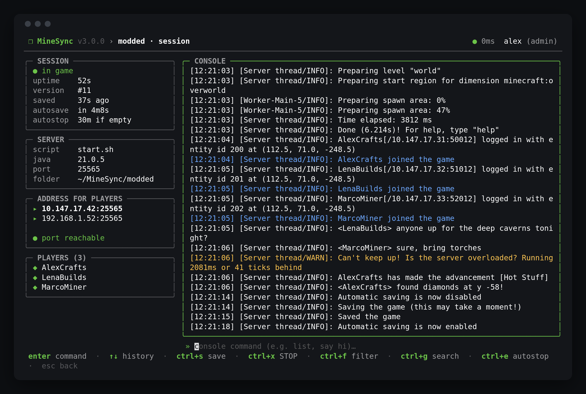</p>

> Client, web UI and Telegram bot speak **English and Italian**: see [Language](#10-language).

---

## Contents

- [Visuals](#visuals)
- [Features](#features)
- [Installation](#installation)
- [Requirements](#requirements)
- [Guide](#guide)
  - [1. Hub configuration](#1-hub-configuration)
  - [2. Access model](#2-access-model)
  - [3. Moving an existing world in](#3-moving-an-existing-world-in)
  - [4. Playing](#4-playing)
  - [5. A fixed address for everyone (DNS)](#5-a-fixed-address-for-everyone-dns)
  - [6. Telegram announcements](#6-telegram-announcements)
  - [7. Signed client updates](#7-signed-client-updates)
  - [8. Command line](#8-command-line)
  - [9. Development](#9-development)
  - [10. Language](#10-language)
- [Licence](#licence)

## Visuals

#### The client

Pick a server, press **G**: the client takes the lock, pulls what changed, starts the server and keeps it saved on the hub.

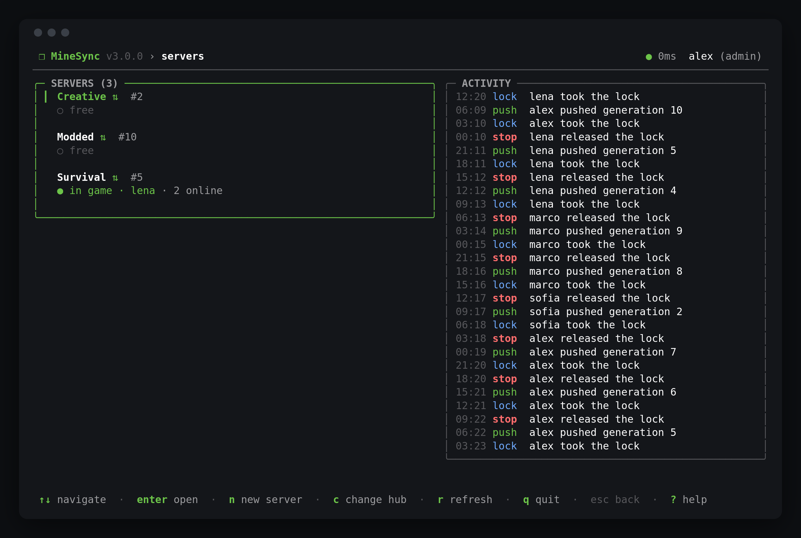 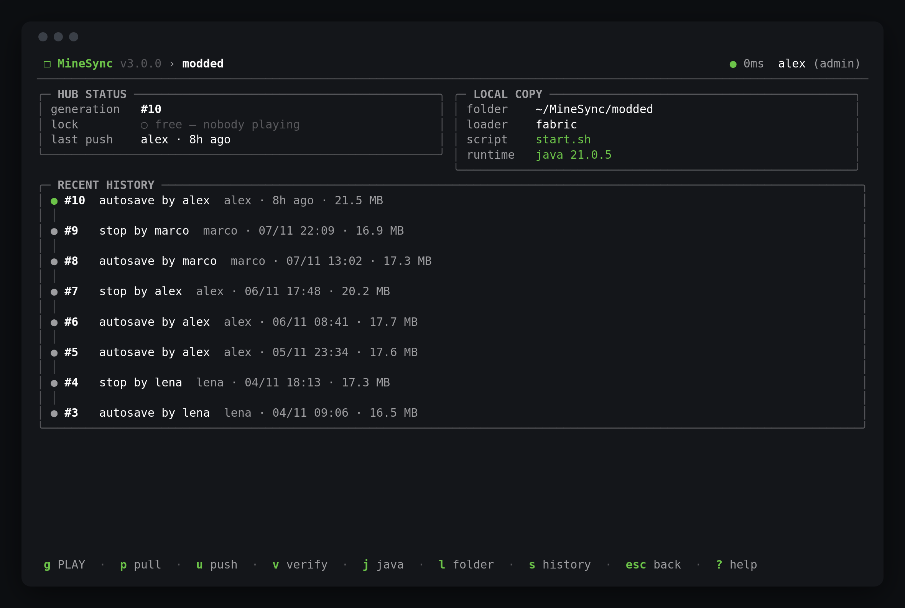
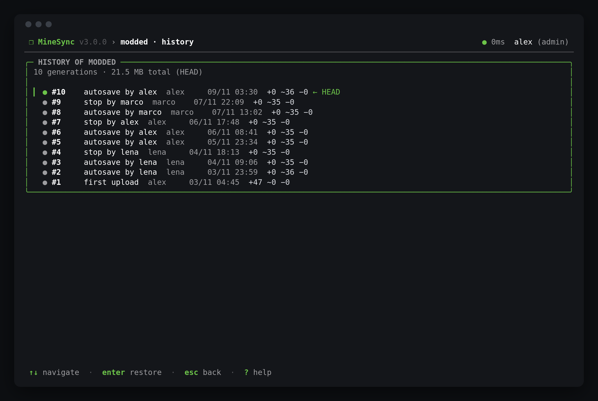 

#### The hub's web UI

Who is playing where, the fixed address to join, world details, players, mods and the full history with restore.

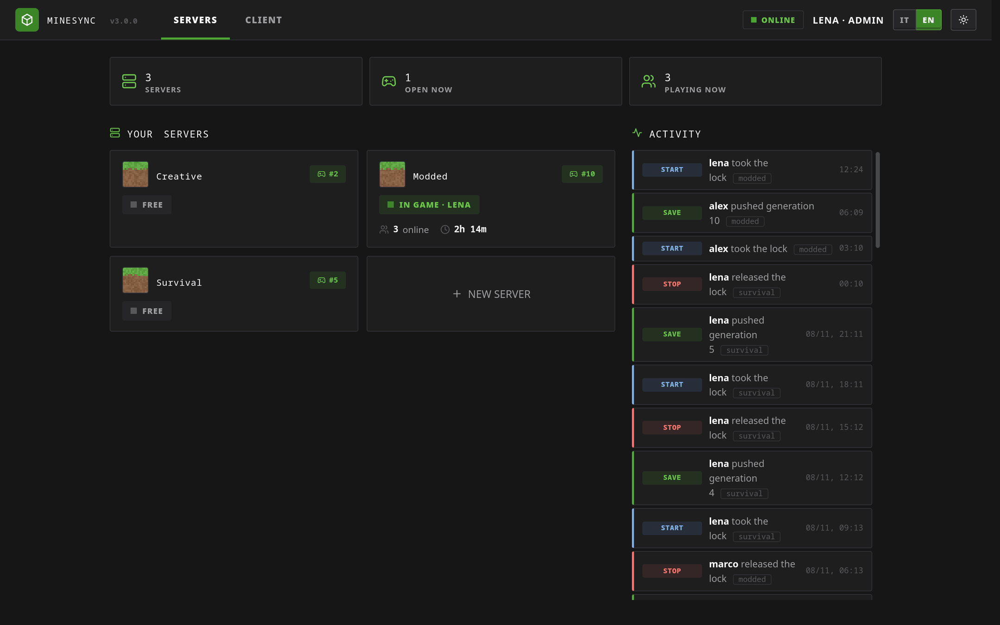

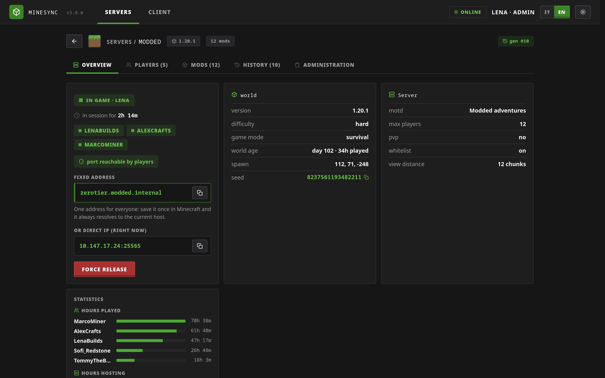 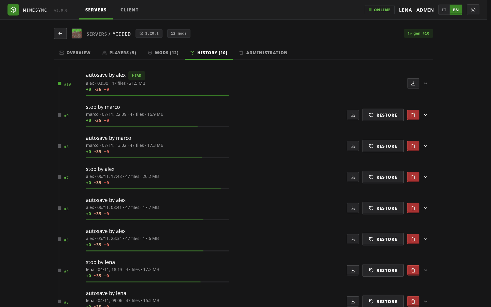
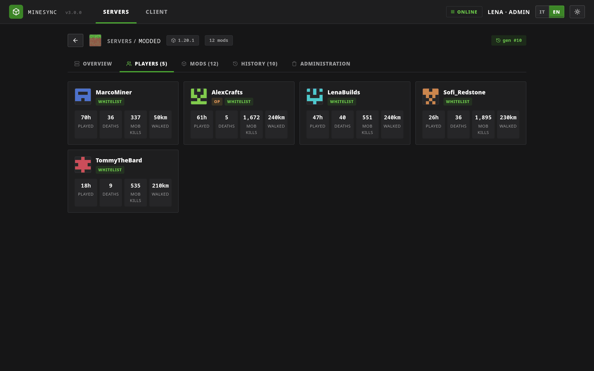 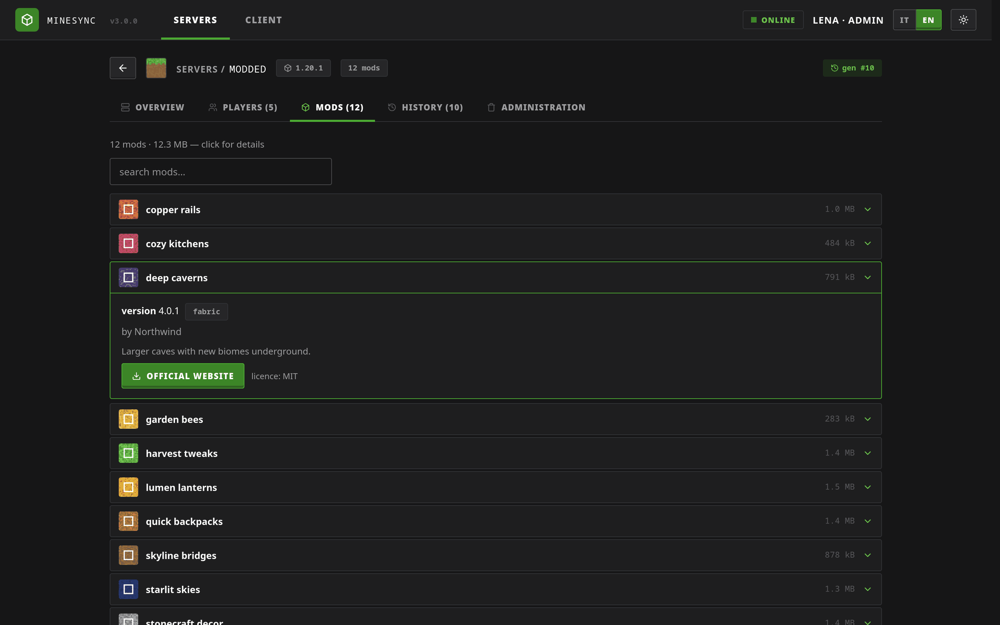

#### Light theme and Italian, client downloads

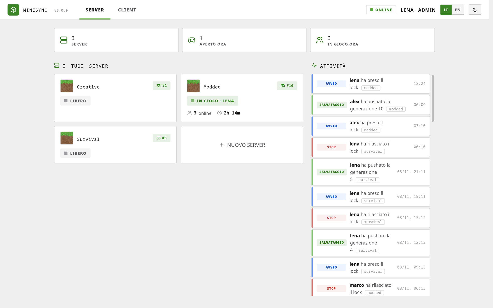 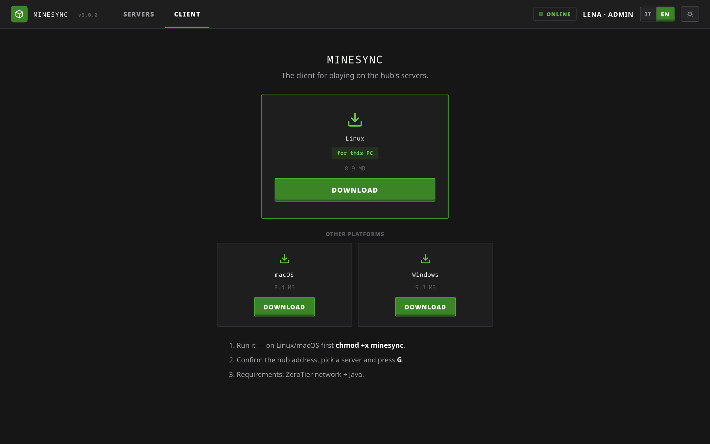

## Features

**Hub** (`server/`, one static Go binary, no dependencies)
- Content-addressed store (SHA-256, region files split into chunks): a generation only stores what changed.
- Git-like **generations** with restore of a whole world or of a single file, ZIP export of any generation.
- A **lock per space** with heartbeat and TTL: only one host at a time, a crashed PC frees it after 90 s.
- Safe retention: automatic pruning never touches the last 24 hours and keeps one generation per day for a week; mass deletions are refused.
- Embedded **web UI**: spaces, live lock and players, history with restore, world info (seed, version, mods with icons, player stats), events feed, client downloads.
- Optional **DNS** (`zerotier.<space>.internal` → whoever is hosting now) and **Telegram** bot announcing when a server opens and closes.
- Checks from the hub that the host's game port is reachable, so a blocking firewall shows up before anyone complains.

**Client** (`client/`, one binary per OS, TUI + CLI)
- Detects the server layout (start scripts, launcher jars, loaders) and picks a suitable Java.
- Pull → start → embedded console (history, filters, search, colours) → autosave + push every 5 minutes (`save-off` / `save-all flush` / push / `save-on`) → clean stop with final push.
- Refuses to overwrite local changes that never reached the hub; pushes them first when it is safe, or asks (and keeps a backup) when it is not.
- Autostop after 30 minutes with nobody online, automatic restart after a crash (up to 2 times).
- Self-update from the hub, verified with SHA-256 and, optionally, an ed25519 signature.

## Installation

The hub joins the ZeroTier container's network namespace, so it is reachable **only** from inside the ZeroTier network. It uses [ZTNET](https://ztnet.network) to know who is calling.

```yaml
services:
  minesync:
    image: ghcr.io/ales-drnz/minesync-hub:latest
    container_name: minesync
    restart: always
    stop_grace_period: 30s
    network_mode: service:zerotier
    depends_on:
      - zerotier
      - ztnet
    volumes:
      - minesync_data:/data
    environment:
      - TZ=Europe/Rome
      - ZTNET_URL=http://ztnet:3000
      - ZTNET_API_TOKEN=<ztnet-api-token>
      - ZTNET_NETWORK_ID=<network-id>
      - MINESYNC_ADMINS=<your-member-name-or-node-id>

volumes:
  minesync_data:
```

Then open `http://<hub-zerotier-ip>:8084`. Friends download the client from `http://<hub-zerotier-ip>:8084/dl`.

A fully commented example (DNS, Telegram, building from source, running with your own UID) is in [deploy/docker-compose.example.yml](deploy/docker-compose.example.yml).

## Requirements

- A ZeroTier network managed with [ZTNET](https://ztnet.network) and an API token for it.
- Docker on an always-on machine that is a member of the network (the hub).
- On the PCs that host: Java matching the modpack (the client finds the system Java, launcher runtimes, SDKMAN and a runtime shipped with the server folder).
- Nothing at all on the PCs that only join the game.

## Guide

### 1. Hub configuration

| Variable | Default | Meaning |
|---|---|---|
| `ZTNET_URL` | — | ZTNET base URL, e.g. `http://ztnet:3000` (**required**) |
| `ZTNET_API_TOKEN` | — | ZTNET API token (**required**) |
| `ZTNET_NETWORK_ID` | — | ZeroTier network id (**required**) |
| `MINESYNC_ADMINS` | — | Comma-separated admins: ZTNET member names or 10-character node ids. Prefer node ids: names are not unique |
| `MINESYNC_ADDR` | `:8084` | HTTP listen address |
| `MINESYNC_DATA` | `/data` | Data directory (use a local disk, not SMB/NFS) |
| `MINESYNC_KEEP` | `30` | Generations kept per space by automatic retention (plus the last 24 h and one per day for a week) |
| `MINESYNC_HOSTS` | — | Extra host names allowed to reach the hub (e.g. `minesync.lan`); IP addresses and names in the DNS zone are always allowed |
| `MINESYNC_DNS_ZONE` | `internal` | Zone for the fixed addresses, see [§5](#5-a-fixed-address-for-everyone-dns) |
| `MINESYNC_DNS_ADDR` | `:53` | DNS listen address, `off` to disable |
| `MINESYNC_TELEGRAM_TOKEN` / `MINESYNC_TELEGRAM_CHAT` | — | Optional bot, see [§6](#6-telegram-announcements) |
| `MINESYNC_LANG` | from `LANG`, else `en` | Language of the Telegram bot and of the hub's logs: `en` or `it` |
| `MINESYNC_DL` | `/opt/dl` | Folder with the client binaries served on `/dl` |
| `MINESYNC_DEV_USER` | — | **Development only**: authenticates loopback requests as this admin |

### 2. Access model

There are no passwords and no tokens: **the ZeroTier network is the authentication**. A request coming from the address of an authorised member is that member, with the name it has in ZTNET. Admins (from `MINESYNC_ADMINS`) can create and delete spaces, restore and delete generations, change the exclusions, run the garbage collector, push without the lock and break someone else's lock before it expires. Everybody else can play, push while holding the lock, browse the history and download backups.

Everyone in a space runs the server code that comes with it (mods are code, and so are start scripts and bundled Java runtimes), so only invite people you trust to the network.

The web UI and the API also refuse requests coming from other web sites (no CSRF, no DNS rebinding): state-changing calls need the `X-MineSync` header, and the `Host` must be an IP address, a name in the DNS zone or one listed in `MINESYNC_HOSTS`.

To add a friend: authorise them on the network in ZTNET, send them `http://<hub-ip>:8084/dl`, done.

### 3. Moving an existing world in

From the PC that has the world:

```sh
minesync login http://<hub-ip>:8084
minesync create MyServer -p minecraft
minesync link myserver "/path/to/the/server/folder"
minesync push myserver -m "first upload" --nolock     # --nolock is admin-only
```

The space now has generation #1 and from here on everyone just uses the TUI.

### 4. Playing

1. Run `minesync`, pick the space, press **G**.
2. The client takes the lock (it tells you who is playing if someone is; a stale lock is replaced automatically).
3. It pulls only the changed files, starts the server and shows the console: commands, `↑`/`↓` history, **Ctrl+F** filter by level, **Ctrl+G** search.
4. Every 5 minutes it saves and pushes a generation, so a power cut costs at most a few minutes.
5. **Ctrl+X** (or **Ctrl+C**): clean stop, final push, lock released.

The session panel shows whether the hub can reach your game port, who is online, the countdown to the next autosave and a warning when the server cannot keep up. **Ctrl+E** toggles the 30-minute autostop. Press **?** anywhere for every key.

If the final push of a session fails, nothing is lost: the next time you play, the client notices the local changes and pushes them before pulling. If someone else played in the meantime, it asks before discarding your copy and saves it in `.minesync-backup/` next to the server folder.

### 5. A fixed address for everyone (DNS)

The hosting PC changes, its IP changes with it. The hub can answer DNS for

```
zerotier.<space>.internal   →   the ZeroTier IP of whoever is hosting now
```

so everybody saves **one** address in Minecraft and never touches it again. The host itself gets its LAN IP (split horizon). It is only a name lookup: the game traffic stays direct.

1. In ZTNET → network → DNS: search domain `internal`, server address `<hub-zerotier-ip>`.
2. Every member enables **Allow DNS** in the ZeroTier app (`zerotier-cli set <network-id> allowDNS=1`).
3. **Linux**: the official ZeroTier client ignores pushed DNS on Linux. Use `systemd-resolved` and either [zerotier-systemd-manager](https://github.com/zerotier/zerotier-systemd-manager) or the [ZeroTierOne fork with native resolved support](https://github.com/ales-drnz/ZeroTierOne/tree/linux-managed-dns). Test with `getent hosts` or `resolvectl query`: `host` and `dig` bypass resolved.
4. **Windows**, if `.internal` does not resolve: an NRPT rule (PowerShell as admin)
   `Add-DnsClientNrptRule -Namespace ".internal" -NameServers "<hub-zerotier-ip>"`.

Port 53 is privileged: the image already allows the binary to bind it. If you run the container with `no-new-privileges`, set `net.ipv4.ip_unprivileged_port_start=53` on the ZeroTier container instead, or `MINESYNC_DNS_ADDR=off`. Minecraft caches lookups for about 30 seconds, so a client that is already open may take that long to see a new host.

### 6. Telegram announcements

```
🟢 myserver è aperto              🔴 myserver è chiuso
👤 hosta alex                      ⏱ sessione di 2h 15m
🌐 zerotier.myserver.internal
📡 10.147.17.20
```

Set `MINESYNC_TELEGRAM_TOKEN` (from [@BotFather](https://t.me/BotFather)) and `MINESYNC_TELEGRAM_CHAT` (the group id, negative). How to find the id is explained in the compose example. If the host's PC dies, the hub still announces the closing when the lock expires.

### 7. Signed client updates

Clients update themselves from the hub when it runs a newer version, never to an older one. Every download is checked against `SHA256SUMS`. To also protect against someone impersonating the hub on the network, sign the binaries:

```sh
go run ./scripts/sign keygen minesync-sign.key    # prints the public key; keep the .key private
```

- **GitHub image**: add the key file's content as the `MINESYNC_SIGN_KEY` secret of your fork; CI signs and embeds the public key.
- **Your own build**: `docker build -f deploy/Dockerfile --secret id=minesync_sign_key,src=minesync-sign.key .` or `MINESYNC_SIGN_KEY=minesync-sign.key scripts/build.sh`.

Clients built with a public key refuse any update that is not signed by it.

### 8. Command line

```
minesync                         TUI
minesync login <url>             set the hub address
minesync spaces                  list spaces
minesync create <name> -p <profile>
minesync link <space> <folder>   bind a space to a local folder
minesync status <space>
minesync pull <space> [--discard-local]
minesync push <space> -m <message> [--nolock]
minesync prefetch <space>        download in the background what the next pull needs
minesync verify <space>          check region files against the hub
```

### 9. Development

```sh
go test -race ./server/... ./client/...     # from the repository root (go.work)
scripts/build.sh                            # hub + every client into ./dist
MINESYNC_DEV_USER=me MINESYNC_DATA=/tmp/ms MINESYNC_DNS_ADDR=off go run ./server
```

The architecture is described in [DESIGN.md](DESIGN.md), the changes in [CHANGELOG.md](CHANGELOG.md).

### 10. Language

Everything a user sees exists in English and Italian.

- **Client**: `MINESYNC_LANG=en|it` if set, otherwise the language saved in the TUI, otherwise the system language (falls back to English). Switch it from the home screen of the TUI (see **?**); the choice is saved.
- **Web UI**: follows the browser, with an EN/IT selector in the header that is remembered.
- **Hub**: API errors and the `/dl` page follow the language of whoever asks; the Telegram bot and the logs use `MINESYNC_LANG` (or `LANG`), English by default.

## Licence

BSD 3-Clause, see [LICENSE](LICENSE).

The web UI embeds the [Press Start 2P](https://fonts.google.com/specimen/Press+Start+2P) font by CodeMan38, under the SIL Open Font License 1.1 ([OFL.txt](server/internal/web/static/OFL.txt)). The screenshots use made-up servers, players and mods.
