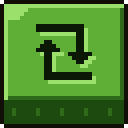
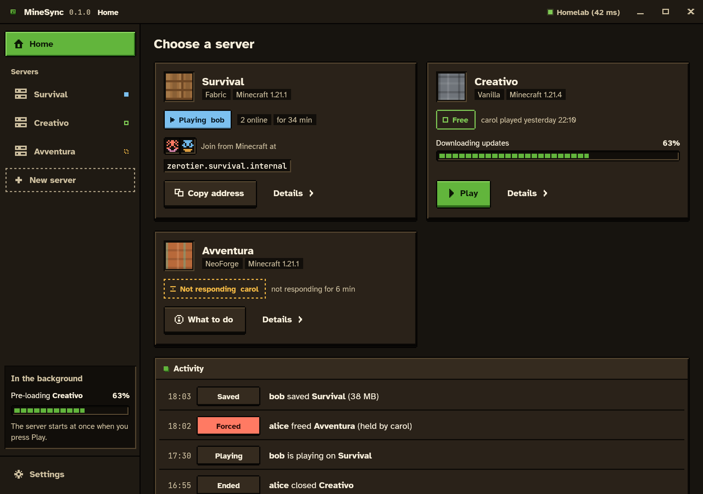
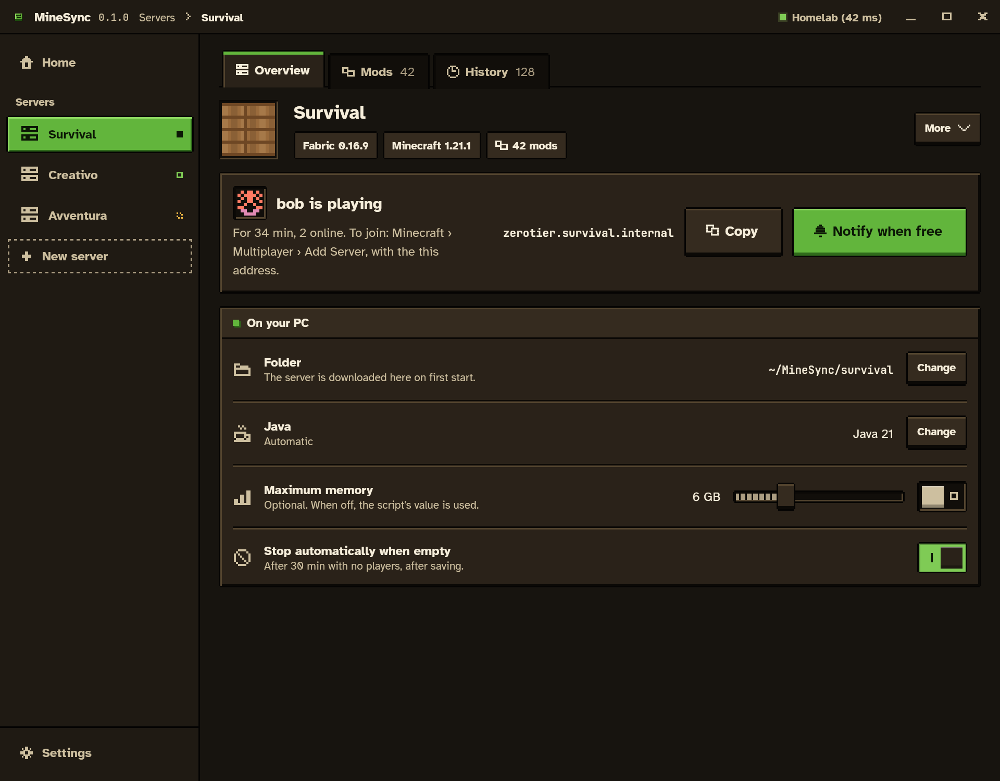
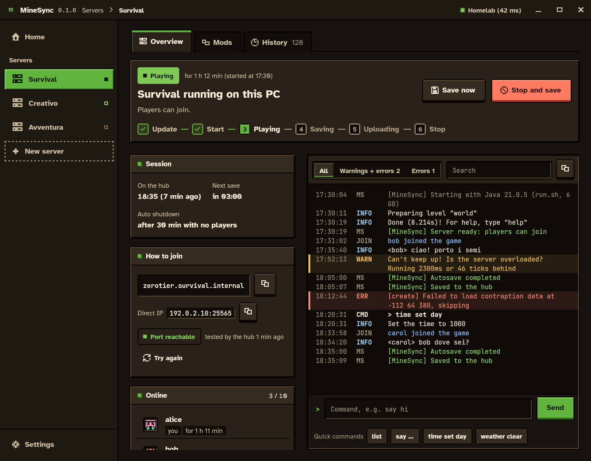
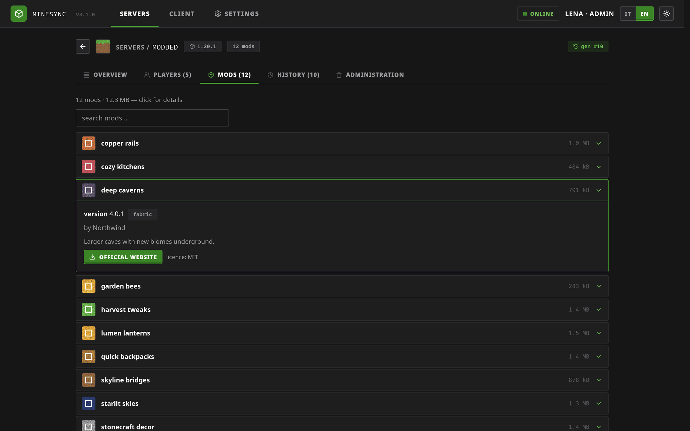
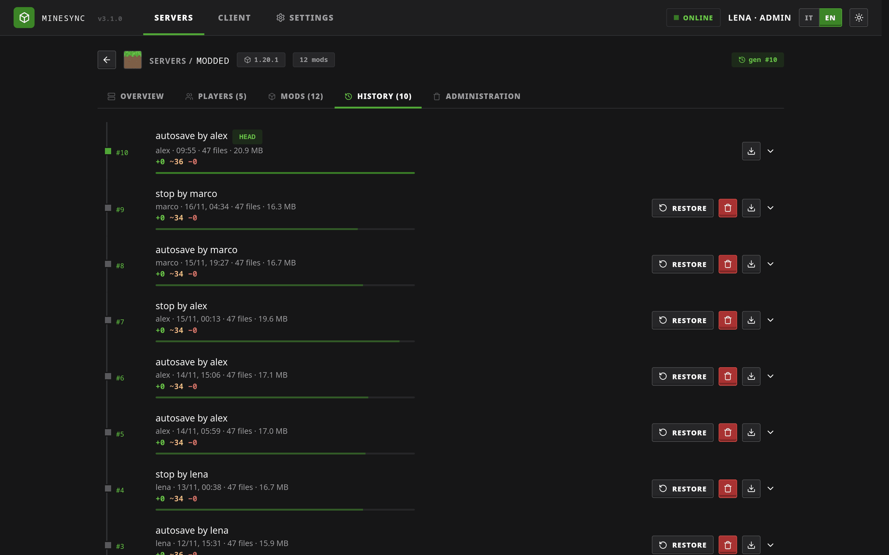
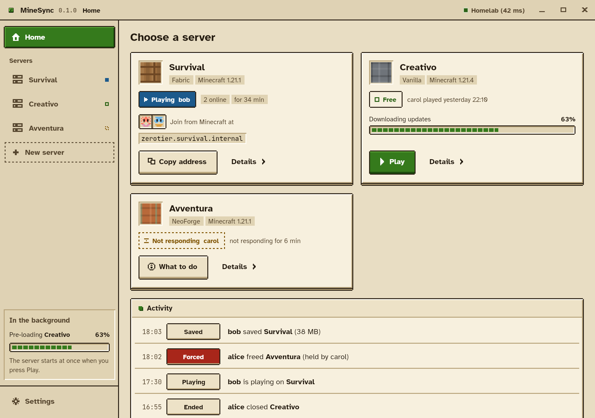
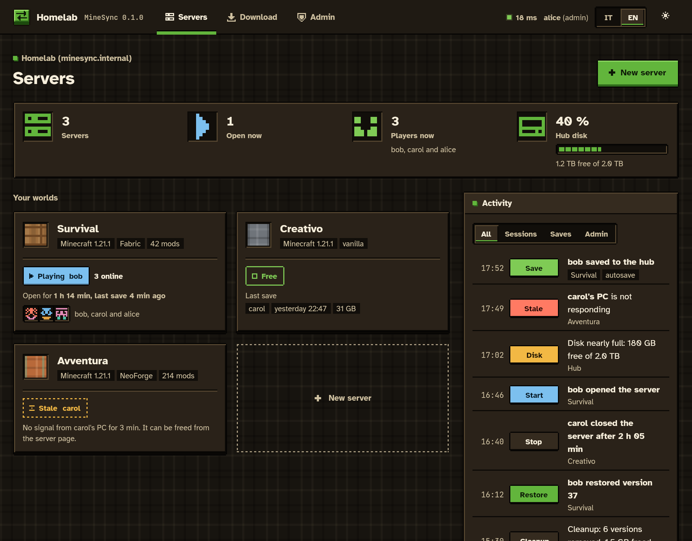
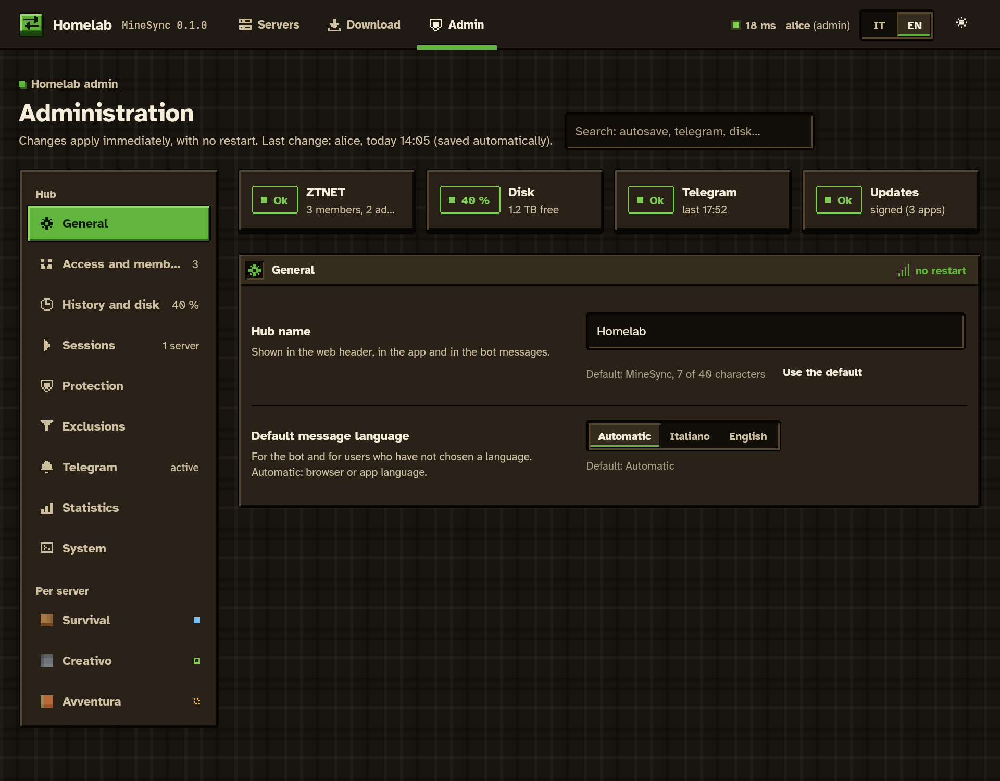
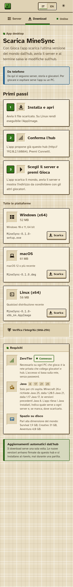

# MineSync

#### One Minecraft server, shared between friends.

[](https://github.com/ales-drnz/minesync/releases)
[](LICENSE)
[](https://ztnet.network)
[](#installation)
[](apps)
[](https://github.com/ales-drnz/minesync)
[](https://discord.gg/g2Qf4Mq9MP)
[](https://www.patreon.com/cw/ales_drnz)
[](https://www.buymeacoffee.com/ales.drnz)

<table>
<tr>
<td valign="middle" width="90"></td>
<td valign="middle"><code>minesync</code> lets a group of friends play the same Minecraft server without keeping a PC on all the time. A small hub on a NAS keeps the world and its <b>whole history</b>; whoever wants to play presses <b>Play</b>, and the desktop app downloads what changed, starts the server on that PC and saves back to the hub while everyone plays. The others join over a private <a href="https://www.zerotier.com">ZeroTier</a> network, and nobody needs a password: you are who your ZeroTier membership says.</td>
</tr>
</table>

---

## Installation

### The hub

The hub runs next to ZeroTier on an always-on machine, sharing the ZeroTier container's network: it is reachable **only** from inside your ZeroTier network, and no port is published on the LAN.

```yaml
services:
  zerotier:
    image: zyclonite/zerotier:1.14.2
    container_name: zerotier
    restart: unless-stopped
    cap_add: [NET_ADMIN, SYS_ADMIN]
    devices:
      - /dev/net/tun:/dev/net/tun
    volumes:
      - zerotier:/var/lib/zerotier-one
    ports:
      - "9993:9993/udp"

  minesync:
    image: ghcr.io/ales-drnz/minesync-hub:latest   # or :0.1 to stay on 0.1.x, or :0.1.0 for exactly that release
    container_name: minesync
    restart: unless-stopped
    network_mode: service:zerotier
    depends_on: [zerotier]
    stop_grace_period: 30s
    read_only: true
    cap_drop: [ALL]
    security_opt: ["no-new-privileges:true"]
    volumes:
      - minesync_data:/data                     # a local disk, never SMB or NFS
    environment:
      - TZ=Europe/Rome
      - ZTNET_URL=http://ztnet:3000
      - ZTNET_API_TOKEN=your-ztnet-api-token
      - ZTNET_NETWORK_ID=your-16-char-network-id
      - MINESYNC_ADMINS=your-10-char-node-id     # comma-separated

volumes:
  zerotier:
  minesync_data:
```

Then join the hub to your network and authorise it in ZTNET:

```bash
docker compose up -d
docker compose exec zerotier zerotier-cli join <network-id>
```

The ZTNET API token is created in ZTNET under *Account → API*. The full example, with ZTNET itself and the optional DNS, is [`deploy/docker-compose.example.yml`](deploy/docker-compose.example.yml).

### The app

Open `http://<zerotier-ip-of-the-hub>:8084` from any device in the network and download the app for your system from the *Download* page. On first start the app asks for the hub address; after that it updates itself from your hub, with signed packages.

On the PC that hosts, allow the Minecraft port (25565 by default) through the firewall, for example `sudo ufw allow 25565/tcp`. The hub tells you when it is closed.

## Requirements

| | Minimum | Notes |
| :--- | :--- | :--- |
| **Hub** | Linux on amd64 or arm64 with Docker | or the `minesync-hub` binary directly. `/data` on a local disk |
| **ZeroTier** | 1.14 | the network is managed with [ZTNET](https://ztnet.network), which knows who everyone is |
| **Windows** | 10 22H2, x64 | installer |
| **macOS** | 13 Ventura, Apple Silicon or Intel | dmg |
| **Linux** | glibc 2.31 (Ubuntu 20.04, Debian 11, Fedora 32), x64 or arm64 | AppImage |
| **Minecraft** | Vanilla, Fabric, Quilt, Forge, NeoForge, Paper | the app finds a suitable Java on the PC, or tells you which one to install |
| **Browser** | any evergreen browser | for the hub's web pages. WebAssembly where supported, JavaScript elsewhere |

---

## Contents

* [Visuals](#visuals)
* [Features](#features)
* [Quick start](#quick-start)
* [Guide](#guide)
  <details>
  <summary><a href="#1-the-hub"><b>1. The hub</b></a></summary>

  * [1.1 Environment variables](#11-environment-variables)
  * [1.2 Admins and members](#12-admins-and-members)
  * [1.3 A fixed address for every server](#13-a-fixed-address-for-every-server)

  </details>

  <details>
  <summary><a href="#2-playing"><b>2. Playing</b></a></summary>

  * [2.1 One host at a time](#21-one-host-at-a-time)
  * [2.2 Saving while you play](#22-saving-while-you-play)
  * [2.3 Joining](#23-joining)

  </details>

  <details>
  <summary><a href="#3-history"><b>3. History</b></a></summary>
  </details>

  <details>
  <summary><a href="#4-mods"><b>4. Mods</b></a></summary>
  </details>

  <details>
  <summary><a href="#5-privacy"><b>5. Privacy</b></a></summary>
  </details>

  <details>
  <summary><a href="#6-development"><b>6. Development</b></a></summary>
  </details>

* [Licence](#licence)

---

## Visuals

#### Home: every server, who is playing, what happened

<p align="center">
  
</p>

#### A server someone is hosting, with the address to join

<p align="center">
  
</p>

#### Your session: steps, console and players

<p align="center">
  
</p>

#### Server mods from Modrinth, with updates and the player pack

<p align="center">
  
</p>

#### Every save is a version you can go back to

<p align="center">
  
</p>

#### Light theme

<p align="center">
  
</p>

#### The hub's web pages: servers, activity and the Admin area

<p align="center">
  
</p>

<p align="center">
  
</p>

#### On a phone

<p align="center">
  
</p>

---

## Features

<table>
<tr>
<td valign="middle" width="48"></td>
<td valign="middle" width="45%"><b>One host at a time</b><br>a lock with a heartbeat: two people never run the same world. A host that stops answering is shown as such, and can be taken over.</td>
<td valign="middle" width="48"></td>
<td valign="middle" width="45%"><b>Saved while you play</b><br>every few minutes the world is flushed, snapshotted and uploaded in the background, without stopping the game, within a bandwidth limit.</td>
</tr>
<tr>
<td valign="middle"></td>
<td valign="middle"><b>A full history</b><br>every save is a version: see what changed, go back to any of them, download one as a ZIP. Files are stored once, however many versions share them.</td>
<td valign="middle"></td>
<td valign="middle"><b>Nothing lost by surprise</b><br>changes on your PC that never reached the hub are kept and shown, never overwritten; mass deletions and saves on an old base are refused.</td>
</tr>
<tr>
<td valign="middle"></td>
<td valign="middle"><b>A real server session</b><br>console with filters and commands, players online, crash restarts, and an automatic stop when nobody has been online for a while.</td>
<td valign="middle"></td>
<td valign="middle"><b>Mods from Modrinth</b><br>add, update and remove server mods with their dependencies; new servers from scratch, from a modpack or from a folder.</td>
</tr>
<tr>
<td valign="middle"></td>
<td valign="middle"><b>The player pack</b><br>the mods players need, ready for Prism Launcher or the official launcher, built by the hub from the server's own list.</td>
<td valign="middle"></td>
<td valign="middle"><b>One address per server</b><br>an optional built-in DNS points <code>zerotier.&lt;server&gt;.&lt;zone&gt;</code> at whoever hosts tonight, and checks that their port answers.</td>
</tr>
<tr>
<td valign="middle"></td>
<td valign="middle"><b>Telegram</b><br>an optional bot says when a server opens and closes, warns about problems and answers <code>/status</code>, with a forum topic per server.</td>
<td valign="middle"></td>
<td valign="middle"><b>Admin area</b><br>history rules, protection, sessions, Telegram, DNS and members, in the hub's web pages; every setting applies at once, no restart.</td>
</tr>
<tr>
<td valign="middle"></td>
<td valign="middle"><b>Signed updates</b><br>the app updates itself from your hub, checks the signature and goes back to the previous version if the new one does not start.</td>
<td valign="middle"></td>
<td valign="middle"><b>English and Italian</b><br>light and dark themes, two palettes, larger interface sizes, keyboard and screen reader support, and never colour alone for a state.</td>
</tr>
</table>

---

## Quick start

Try the hub and the app on one PC, without ZeroTier: `MINESYNC_DEV_USER` makes every request come from one development user. Building needs [Flutter](https://docs.flutter.dev/get-started) 3.47.5.

```bash
git clone https://github.com/ales-drnz/minesync.git
cd minesync
flutter pub get --enforce-lockfile
(cd apps/hub_web && flutter build web --wasm)
MINESYNC_DATA=/tmp/minesync-hub MINESYNC_ADDR=127.0.0.1:8084 \
  MINESYNC_DEV_USER=alice MINESYNC_ADMINS=dev-alice \
  MINESYNC_WEB=apps/hub_web/build/web dart run apps/hub/bin/hub.dart
```

In another terminal start the app and enter `http://127.0.0.1:8084` as the hub:

```bash
cd apps/desktop && flutter run -d linux   # or windows / macos
```

---

## Guide

### 1. The hub

#### 1.1 Environment variables

| Variable | Default | Description |
| :--- | :--- | :--- |
| `ZTNET_URL` | — | ZTNET address, from inside the Docker network |
| `ZTNET_API_TOKEN` | — | **required**. Stays on the hub |
| `ZTNET_NETWORK_ID` | — | **required**. The 16-character network id |
| `MINESYNC_ADMINS` | — | admins: ZTNET member names or 10-character node ids, comma-separated. Node ids are safer, two members may share a name |
| `MINESYNC_ADDR` | `:8084` | listening address of the API, the web pages and the downloads |
| `MINESYNC_HOSTS` | — | extra host names used to open the web pages. IP addresses, `localhost` and names in the DNS zone always work |
| `MINESYNC_DNS_ZONE` | — | turns on the built-in DNS, see [1.3](#13-a-fixed-address-for-every-server) |
| `MINESYNC_DNS_ADDR` | `:53` | DNS listening address, with a zone. `off` disables it |
| `MINESYNC_MIN_FREE` | — | refuse uploads below this free space, e.g. `5GiB` |
| `MINESYNC_MAX_UPLOADS` | `4` | uploads read in parallel |
| `MINESYNC_DATA` | `/data` | where the hub keeps worlds, history and settings. Set by the image |
| `TZ` | — | time zone of the logs and of the Telegram bot |

Everything else, from history rules to Telegram, is set in the web pages, under *Admin*.

#### 1.2 Admins and members

Everyone authorised in your ZeroTier network is a member, with their ZTNET name. Members can play, see every server, its history and its activity, and download the app and the player pack. Admins also create servers, change mods, go back to an old version, free a server held by someone who stopped answering, clean up the history and change the hub's settings.

#### 1.3 A fixed address for every server

Whoever hosts changes from evening to evening, and so does the address to type in Minecraft. With `MINESYNC_DNS_ZONE=internal` the hub answers `zerotier.<server>.internal` with the ZeroTier address of whoever hosts that server now, plus an SRV record for the port. Point the network's DNS at the hub in ZTNET (*DNS → domain `internal`, server: the hub's ZeroTier address*) and the address in Minecraft never changes. The game itself still goes straight to the host's PC.

### 2. Playing

#### 2.1 One host at a time

Pressing **Play** takes the server's lock on the hub. While you hold it, the others see that you are playing, how many are online and the address to join. If your PC stops answering, the server shows as *not responding*: you can resume it from the same PC, and an admin can free it after two confirmations.

#### 2.2 Saving while you play

Every 5 minutes, by default, the app asks the server to flush the world to disk, takes a snapshot and uploads what changed in the background. The game never stops. When you close, the final state is uploaded and the lock is freed. If the server crashes it is restarted twice, by default, and an empty server stops itself after 30 minutes. These defaults are set per server in the Admin area.

#### 2.3 Joining

Friends join from Minecraft with the host's ZeroTier address (or the fixed one, [1.3](#13-a-fixed-address-for-every-server)), and with the same mods: the *Player pack* page has them ready for Prism Launcher or the official launcher.

### 3. History

Every save is a version with an author, a time and the files that changed. By default the hub keeps the last 30 versions, every version of the last 24 hours and one per day for 7 days; the Admin area changes these rules and shows what a cleanup would remove before doing it. Going back to a version never deletes the newer ones: it adds a new version with the old content.

Files are split into pieces stored once by their hash, so a hundred versions of a world cost little more than one.

### 4. Mods

The *Mods* tab of a server lists its mods with their icons, finds them on Modrinth, and offers updates that fit the server's Minecraft version and loader. Changes are collected first and applied together, at the next Play. Each mod says where it is needed: on the server, for the players, or both; the player pack follows from it.

New servers start from scratch (choose Minecraft and loader), from a Modrinth modpack or `.mrpack`, or from a server folder you already have.

### 5. Privacy

- the hub is reachable **only** inside your ZeroTier network;
- people are recognised by their ZeroTier membership: there are no accounts or passwords, and the ZTNET token never leaves the hub;
- worlds stay on your hub and on the PCs of whoever hosts; nothing is sent anywhere else. Mod searches go to Modrinth;
- app updates come from your hub and are checked against a signature before they run.

### 6. Development

```text
packages/ms_protocol   API models and paths, shared by the hub and the apps
packages/ms_core       sync engine: scan, hashing, pieces, pull, push
packages/ms_minecraft  server layout, Java, server.properties, mods
packages/ms_session    the game session: lock, autosave, crash restarts, console
packages/ms_modpack    Modrinth, .mrpack, dependencies, server installers
packages/ms_ui         the pixel design system
packages/ms_l10n       Italian and English strings
apps/hub               the hub (dart:io)
apps/hub_web           the hub's web pages (Flutter web)
apps/desktop           the desktop app (Flutter)
apps/cli               the minesync command line
apps/guard             supervisor of the Minecraft server process
apps/launcher          launcher and signed updates
deploy/                Dockerfile, Compose example, smoke test of the image
docs/                  guides, designs and the behaviour rules
```

```bash
tools/check.sh                                    # format, analysis and every test
dart compile exe apps/hub/bin/hub.dart -o build/minesync-hub
(cd apps/desktop && flutter build linux)          # or windows / macos
docker build --build-arg VERSION=$(cat VERSION) -t minesync-hub -f deploy/Dockerfile .
```

The repository is a pub workspace with one lockfile. The screenshots above are drawn by the apps themselves in their golden tests: after a visual change, regenerate the goldens and run `tools/readme_images.sh`.

More in the guides: [running the hub](docs/guide/hub.md), [the desktop app and the CLI](docs/guide/app.md), [modpacks](docs/guide/modpacks.md), and in the [architecture](docs/design/architecture.md), [protocol](docs/design/protocol.md) and [behaviour rules](docs/spec/behaviour.md).

**Releases** follow [Semantic Versioning](https://semver.org) and are listed in the [changelog](CHANGELOG.md). Set the version in `VERSION`, add its section to the changelog, commit, then push a `vX.Y.Z` tag: CI builds and signs the packages for every system, publishes the `X.Y.Z`, `X.Y` and `latest` images and drafts the GitHub release. See [making a release](docs/release.md).

---

## Licence

The project is **BSD 3-Clause**, in [LICENSE](LICENSE). Bundled fonts: Atkinson Hyperlegible and JetBrains Mono, under the **SIL Open Font License 1.1** (`packages/ms_ui/assets/fonts`). Flutter and its packages keep their own licences. MineSync is not an official Minecraft product and is not affiliated with Mojang or Microsoft.

---

*Developed by Alessandro Di Ronza*
